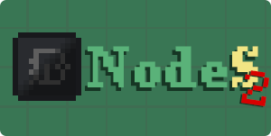

# Hi! ✋
I am *aqur1n*. 

A young developer living on the Internet

## Tools that I use
#### Programming languages

#### Game engines

#### Libraries

## My stats in github
<table class="clean-table">
    <tr>
      <td align="center" style="padding=0;width=100%;">
        
      </td>
      <td align="center" style="padding=0;width=100%;">
        
      </td>
    </tr>
</table>

## My Projects 
<table class="clean-table">
    <tr>
        <td align="center" style="padding=0;width=100%;">
            
        </td>
        <td align="center" style="padding=0;width=100%;">
            
        </td>
    </tr>
</table>
